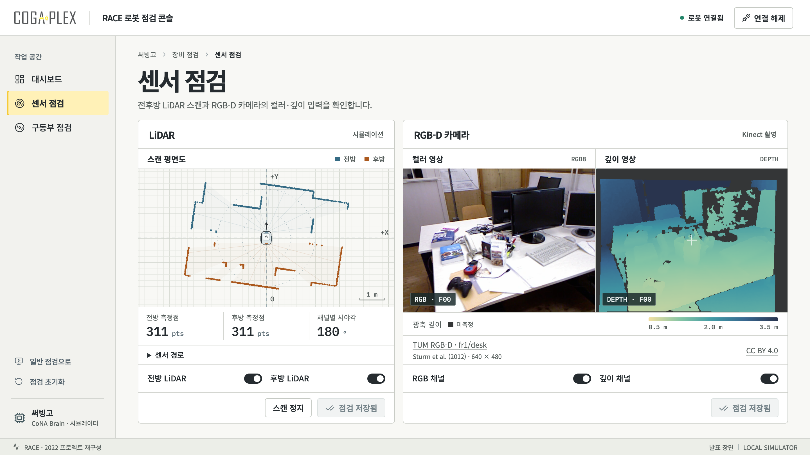
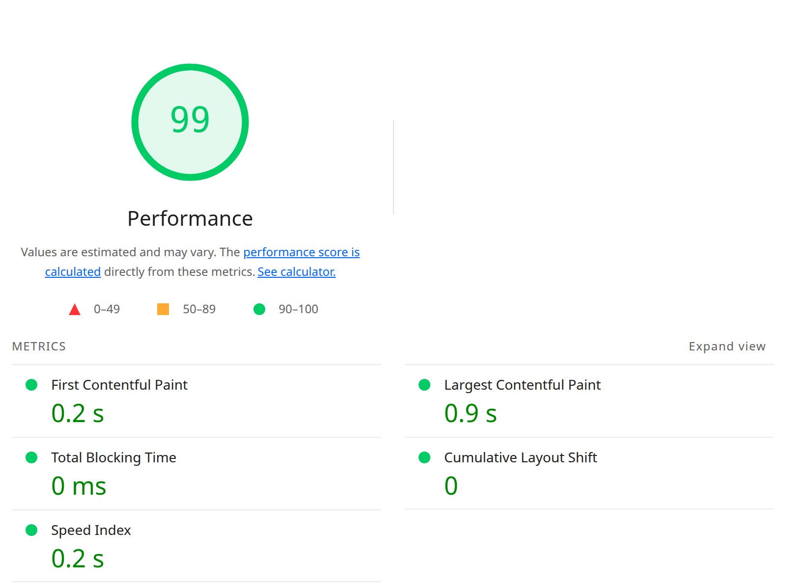

  

    <h1>프론트엔드 엔지니어 김영찬입니다</h1>
    
Frontend Engineer, Robot Data Platform 지원

  

  

    
    이력서
  

---
class: agenda
---

  <h1>차례</h1>
  <ol>
    <li>
      01
      
        코가로보틱스
        양산 로봇 점검 대시보드
      
    </li>
    <li>
      02
      
        더에스엠씨
        SNS 마케팅 데이터 대시보드
      
    </li>
  </ol>

<!--
개요 7장부터 13장은 아직 덱에 없다. 차례에는 있는 두 장만 적는다.
-->

---
class: chapter
---

  
01

  

    
코가로보틱스

    <h1>양산 로봇 점검 대시보드</h1>
  

---
class: shot
---

<h1>점검 대시보드</h1>

  
  
양산 로봇 점검 콘솔

---
class: lead
---

<h1>양산 규모로 늘어난 점검 기록</h1>

---
class: list
---

<h1>이슈</h1>
<ul class="points">
  <li>01손 기록을 엑셀로 다시 옮김</li>
  <li>02통과한 로봇을 추적하기 어려움</li>
</ul>

<!--
양산 규모가 되자 손으로 적은 점검 결과를 다시 엑셀에 옮기고 있었다. 어떤 로봇이 통과했는지 관리하기 어려웠다.
-->

---
class: lead
---

<h1>기록은 흩어지고 판정 기준도 없음</h1>

---
class: lead
---

<h1 class="long">LiDAR 값이 얼마나 벗어나면 재캘리브레이션할지 기준 없음</h1>

---
class: list
---

<h1>점검 항목</h1>

LiDAR · RGB-D 카메라 · LED·스피커 · 구동부

---
class: list
---

<h1>판정 방식을 바꿈</h1>
<ul class="points">
  <li>01순간값 하나로 통과 판정</li>
  <li>02출하 후 현장 이슈</li>
  <li>03일정 구간의 평균값으로 판정</li>
</ul>

---
class: list
---

<h1>웹 점검 도구</h1>
<ul class="points">
  <li>01웹 입력 폼, 통과 여부 먼저</li>
  <li>
    02
    
      실시간 ROS 토픽 구독, 갱신 주기 조절
      rosbridge, roslibjs
    
  </li>
  <li>03로봇별 점검 보고서</li>
</ul>

<!--
화면 맨 앞에 통과 여부를 두고 세부 값은 따로 둔다.
-->

---
class: shot
---

<h1>센서 점검</h1>

  
  
센서 점검 화면

---
class: shot
---

<h1>구동부 점검</h1>

  
  
구동부 점검 화면

---
class: recap
---

  
작업자가 묻는 순서대로 화면을 짠다.

  
작업자는 통과했나를 먼저 묻는다.

  
세부 값은 그다음에 본다.

---
class: chapter
---

  
02

  

    
더에스엠씨

    <h1 class="long">SNS 마케팅 데이터 대시보드</h1>
  

---
class: shot
---

<h1>통합 성과</h1>

  
  
YouTube, Instagram 성과를 한 화면에서 조회하고 비교하는 B2B 대시보드

---
class: lead
---

<h1 class="long">2주마다 Meta, Google Ads에 하나씩 들어가 확인</h1>

<!--
광고주와 마케터에게 2주마다 보고서를 보내야 했다. 그때마다 Meta와 Google Ads에 각각 들어가 확인했다.
-->

---
class: list
---

<h1>문제 정의</h1>
<ul class="points">
  <li>01플랫폼마다 지표 정의가 다름</li>
  <li>02오가닉과 광고를 같은 기간으로 못 봄</li>
  <li>03화면 영역마다 조회 조건이 따로 걸림</li>
</ul>

---
class: list
---

<h1>지표 유형</h1>

누적 · 일별 · 비율 · 도달

---
class: list
---

<h1>시행착오</h1>
<ul class="points">
  <li>01원본 값을 그대로 더함 → 합계 불일치</li>
  <li>02비율 지표를 평균 냄 → 값이 틀림</li>
</ul>

---
class: lead
---

<h1 class="long">백엔드 연동 API(Meta, Google Ads)</h1>

---
class: lead
---

<h1 class="long">지표 유형별 집계 규칙, 다른 지표는 나란히</h1>

---
class: lead
---

<h1>오가닉과 광고를 같은 조회 기간에</h1>

---
class: lead
---

<h1 class="long">Recharts 공용 차트, 조회 조건은 전역 상태 하나</h1>

---
class: shot
---

<h1>추이 차트 · 기간 비교</h1>

  
  
현재 기간 실선, 비교 기간 점선

---
class: shot
---

<h1 class="long">오가닉과 광고를 같은 조회 기간에</h1>

  
  
콘텐츠 리스트

---
class: lead
---

<h1 class="long">콘텐츠가 많은 목록, 첫 화면이 한동안 빈 채로</h1>

---
class: lead
---

원인

<h1 class="long">화면 밖 이미지까지 처음에 한꺼번에 요청</h1>

---
class: list
---

<h1>해결</h1>
<ul class="points">
  <li>01첫 화면 이미지는 바로</li>
  <li>02화면 밖만 지연 로딩</li>
</ul>

---
class: lead
---

<h1 class="long">React Server Component 초기 조회와 스켈레톤 UI</h1>

<!--
React Server Component에서 초기 데이터를 조회하고, 기다리는 동안 스켈레톤 UI로 화면 구조와 로딩 상태를 보여 준다.
-->

---
class: lead
---

원인

<h1 class="long">첫 화면에서 본문 폰트 원본(OTF)을 그대로 받음</h1>

---
class: list
---

<h1>본문 폰트</h1>
<ul class="points">
  <li>01WOFF2로 변환</li>
  <li>02화면에 쓰는 821자만 담은 작은 폰트를 먼저</li>
  <li>03전체 폰트는 필요할 때</li>
</ul>

---
class: list
---

<h1 class="long">제목 폰트와 응답 압축</h1>
<ul class="points">
  <li>01제목 폰트도 WOFF2로, 미리 받기는 유지</li>
  <li>02HTML·JS·CSS 응답 gzip 압축, 첫 화면 전송량 1.17MB → 0.59MB</li>
</ul>

---
class: num-slide
---

  
1차: 이미지

  
2차: 폰트와 응답 압축

  <LcpFigure />
  
0.9초

  
크롬 개발자 도구 Lighthouse · 데스크톱 · 여러 번 측정한 평균

  
Lighthouse CLI · 데스크톱 시뮬레이션 · 조건별 7회 측정 중앙값 · 로컬 브랜치, 운영 미반영

---
class: shot
---

<h1>폰트와 응답 압축으로 0.9초</h1>

  <ul class="points">
    <li>01폰트 경량화: WOFF2, 화면에 쓰는 글자만 먼저</li>
    <li>02응답 gzip 압축: 전송량 1.17MB에서 0.59MB</li>
  </ul>
  

    
    
Lighthouse, 데스크탑 시뮬레이션, 로컬 측정

  

---
class: recap
---

  
2주 보고서 폐지, 담당 2명에서 관리자 1명.

  
같은 조회수라도 플랫폼마다 센 방식이 달랐다.

  
합치기 전에 무엇을 셌는지 확인하고, 다르면 코드에서 갈라 둔다.

---
class: agenda
---

  <h1>차례</h1>
  <ol>
    <li>
      01
      
        코가로보틱스
        양산 로봇 점검 대시보드
      
    </li>
    <li>
      02
      
        더에스엠씨
        SNS 마케팅 데이터 대시보드
      
    </li>
  </ol>

