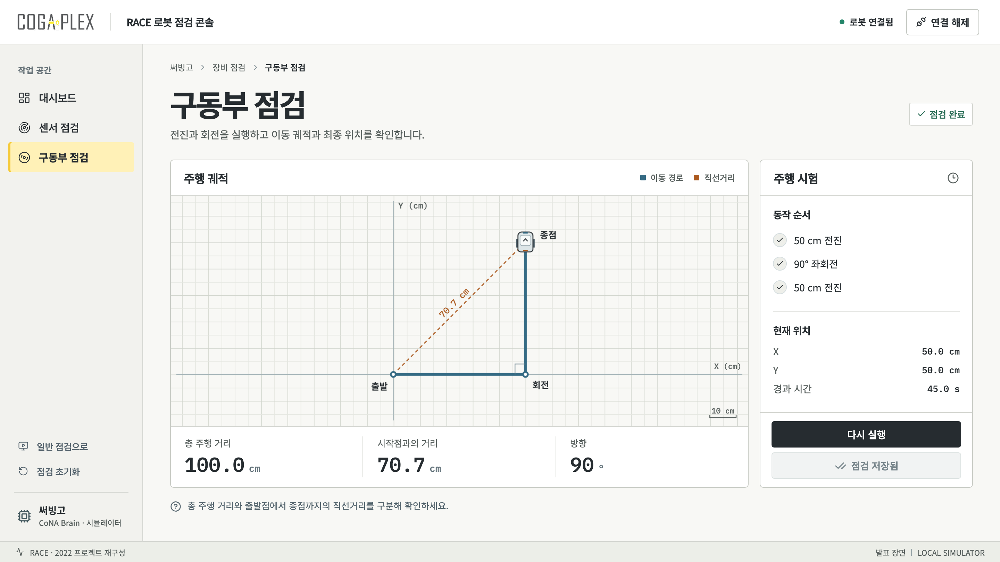
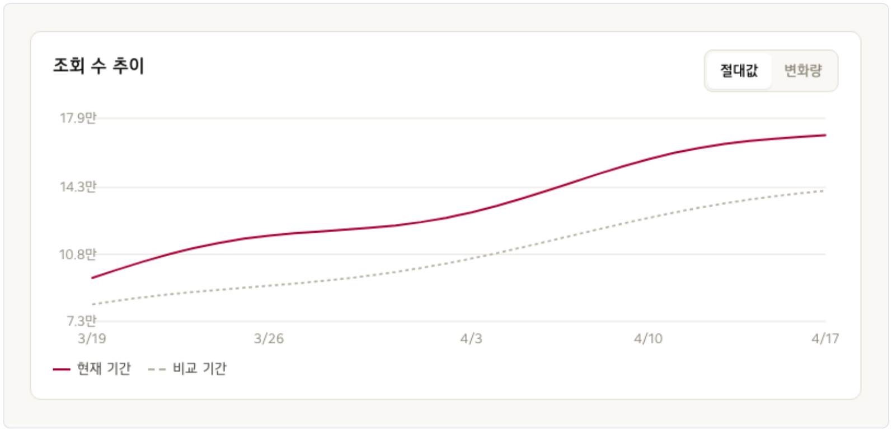
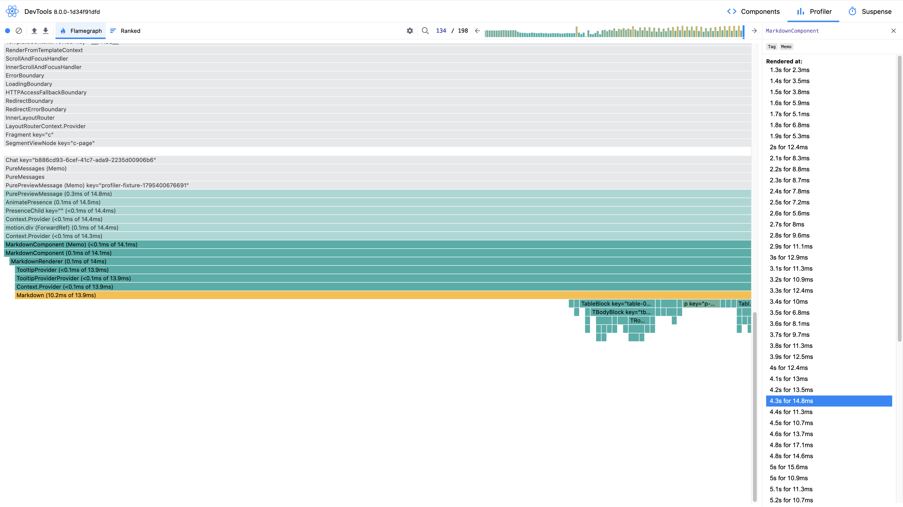
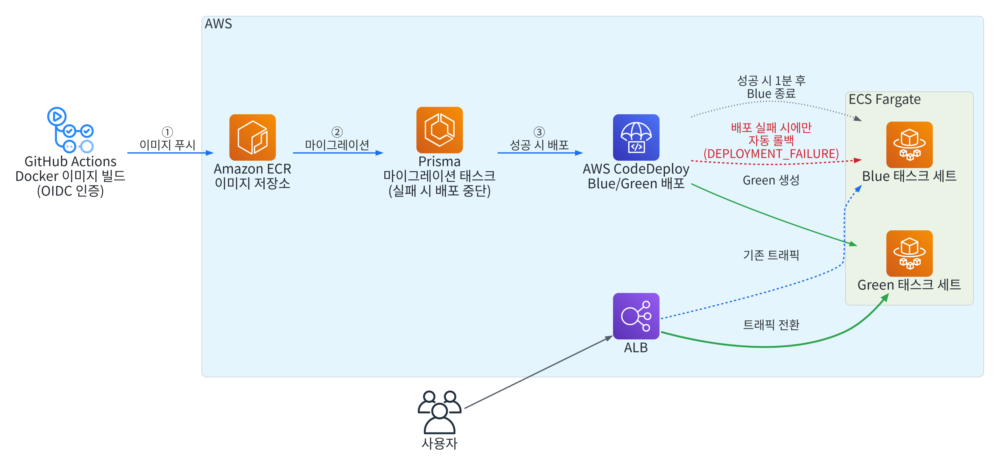

  

    <h1>프론트엔드 엔지니어 김영찬입니다</h1>
    
Frontend Engineer, Robot Data Platform 지원

  

  

    
    이력서
  

---
class: agenda
---

  <h1>차례</h1>
  <ol>
    <li>
      01
      양산 로봇 점검 대시보드
    </li>
    <li>
      02
      SNS 마케팅 데이터 대시보드
    </li>
    <li>
      03
      사내 AI 챗봇
    </li>
    <li>
      04
      AWS 인프라와 배포
    </li>
    <li>
      05
      정산 이상 징후 탐지
    </li>
    <li>
      06
      제조 현장
    </li>
  </ol>

---
class: chapter
---

  
01

  

    
코가로보틱스

    <h1>양산 로봇 점검 대시보드</h1>
  

---
class: shot
---

<h1>점검 대시보드</h1>

  
  
양산 로봇 점검 콘솔

---
class: lead
---

<h1 class="long">로봇은 늘었는데 점검 기록은 여전히 손으로 적고 있는 문제</h1>

---
class: list
---

<h1>이슈</h1>
<ul class="points">
  <li>01손으로 적은 점검 결과를 엑셀에 다시 옮겨야 했습니다</li>
  <li>02어떤 로봇이 통과했는지 한눈에 관리하기 어려웠습니다</li>
</ul>

<!--
양산 규모가 되자 손으로 적은 점검 결과를 다시 엑셀에 옮기고 있었다. 어떤 로봇이 통과했는지 관리하기 어려웠다.
-->

---
class: lead
---

<h1 class="long">검사 통과를 판단할 기준도 대시보드에 내장해 손쉽게 관리</h1>

예: LiDAR 값이 얼마나 벗어나면 재캘리브레이션할지

---
class: list
---

<h1>웹 점검 도구</h1>
<ul class="points">
  <li>01점검 대상: LiDAR · RGB-D 카메라 · LED·스피커 · 구동부</li>
  <li>02판정은 순간값에서 구간 평균으로</li>
  <li>03통과 여부 먼저, 실시간 ROS 토픽, 로봇별 보고서</li>
</ul>

<!--
화면 맨 앞에 통과 여부를 두고 세부 값은 따로 둔다.
-->

---
class: shot
---

<h1>센서 점검</h1>

  
  
센서 점검 화면

---
class: shot
---

<h1>구동부 점검</h1>

  
  
구동부 점검 화면

---
class: chapter
---

  
02

  

    
더에스엠씨

    <h1 class="long">SNS 마케팅 데이터 대시보드</h1>
  

---
class: shot
---

<h1>통합 성과</h1>

  

    

      
    

    
통합 화면

  

  

    
    
콘텐츠 리스트

  

---
class: list
---

<h1>기존에 일하던 방식</h1>
<ul class="points">
  <li>012주마다 Meta, Google Ads에 하나씩 들어가 확인</li>
  <li>02확인할 때마다 보고서를 보냄</li>
  <li>03이 보고를 담당 2명이 맡음</li>
</ul>

<!--
광고주와 마케터에게 2주마다 보고서를 보내야 했다. 그때마다 Meta와 Google Ads에 각각 들어가 확인했다. 이 보고는 담당 2명이 맡았다.
-->

---
class: list
---

<h1>그대로 합치면 틀린다</h1>
<ul class="points">
  <li>01플랫폼마다 지표 정의가 다름</li>
  <li>02누적, 일별, 비율, 도달</li>
  <li>03더하면 합계가 안 맞고, 비율을 평균 내면 값이 틀림</li>
</ul>

---
class: list
---

<h1 class="long">규칙은 나누고 조회는 하나</h1>
<ul class="points">
  <li>01유형별 집계 규칙, 다른 지표는 나란히</li>
  <li>02오가닉과 광고는 같은 기간</li>
  <li>03Recharts 공용 차트, 조회 조건은 전역 상태 하나</li>
</ul>

---
class: shot
---

<h1>추이 차트 · 기간 비교</h1>

  
  
현재 기간 실선, 비교 기간 점선

---
class: shot
---

<h1 class="long">오가닉과 광고를 같은 조회 기간에</h1>

  
  
콘텐츠 리스트

---
class: lead
---

<h1 class="long">첫 화면이 한동안 비어 있었습니다</h1>
<ul class="points">
  <li>01화면 밖 이미지는 나중에 받음</li>
  <li>02초기 조회, 기다리는 동안 스켈레톤</li>
  <li>03쓰는 글자만 WOFF2, gzip 1.17MB에서 0.59MB</li>
</ul>

<!--
화면 밖 이미지까지 처음에 한꺼번에 요청했습니다. 첫 화면만 바로 받고, 밖은 나중에 받게 했습니다. React Server Component에서 초기 데이터를 조회하고, 기다리는 동안 스켈레톤 UI로 화면 구조와 로딩 상태를 보여 줍니다. 본문 폰트는 OTF 원본이었습니다. 화면에 쓰는 글자만 WOFF2로 먼저 받고, HTML·JS·CSS는 gzip으로 1.17MB에서 0.59MB가 됐습니다.
-->

---
class: num-slide
---

  
1차, 이미지

  
2차, 폰트와 압축

  <LcpFigure />
  
3.2초에서 0.9초

  
개발자 도구 Lighthouse, 데스크톱, 여러 번 측정한 평균

  
개발 직후 기준, 두 가지 적용 후. Lighthouse CLI, 데스크톱 시뮬레이션, 조건별 7회 중앙값. 로컬 브랜치, 운영 미반영

---
class: recap
---

  
2주마다 보내던 보고서는 대시보드로 대체하였습니다.

  
담당은 2명에서 관리자 1명이 됐습니다.

  
플랫폼마다 조회수를 세는 방식이 달랐습니다.

  
합치기 전에 무엇을 셌는지 확인하고, 다르면 코드에서 갈라 두었습니다.

---
class: chapter
---

  
03

  

    
더에스엠씨

    <h1>사내 AI 챗봇</h1>
  

---
class: lead
---

<h1 class="long">사내 검색과 외부 AI 모델을 한곳에서 쓰는 채팅</h1>

---
class: list
---

<h1>원인</h1>
<ul class="points">
  <li>01대화를 열면 모든 메시지를 한꺼번에 불러와 그림</li>
  <li>02스트리밍 중 바뀌지 않은 마크다운 블록까지 반복 렌더링</li>
</ul>

---
class: lead
---

<h1 class="long">최근 메시지 먼저, 스크롤하면 이전 메시지 추가</h1>

---
class: lead
---

<h1>21개 → 1개</h1>

커밋당 렌더 시간 평균 11.5ms에서 4.4ms

React DevTools Profiler · 개발 빌드 · 같은 더미 응답 재현 측정

---
class: shot
---

<h1>적용 전</h1>

  

---
class: shot
---

<h1>적용 후</h1>

  

---
class: recap
---

  
느린 이유를 짐작으로 고치면 시간만 든다.

  
숫자로 원인을 확인하고 나서야 맞는 방향이 보였다.

---
class: chapter
---

  
04

  

    
더에스엠씨

    <h1 class="long">AWS 인프라와 배포</h1>
  

---
class: lead
---

<h1 class="long">SNS 마케팅 데이터 대시보드 배포 인프라</h1>

---
class: lead
---

<h1 class="long">배포 자동화, 실패해도 이전 버전 유지</h1>

---
class: list
---

<h1>시행착오</h1>
<ul class="points">
  <li>01AWS 콘솔 수작업</li>
  <li>02관리가 어긋남</li>
  <li>03Terraform. 백엔드 개발자의 기존 구성을 참고하고 코드 리뷰 받음</li>
</ul>

---
class: shot
---

<h1>배포 파이프라인</h1>

  

---
class: shot
---

<h1>실패하면 배포를 멈추고 롤백</h1>

  

---
class: recap
---

  
되돌릴 길이 있어야 자주 배포할 수 있다.

AWS SAA-C03 취득, 2026.10

---
class: chapter
---

  
05

  

    
더에스엠씨

    <h1 class="long">정산 이상 징후 탐지</h1>
  

---
class: lead
---

<h1 class="long">1단계 규칙: 기준에서 크게 벗어난 정산 금액 선별</h1>

---
class: lead
---

<h1 class="long">비고란에 적힌 정당한 사유를 못 읽어 오탐이 생김</h1>

---
class: lead
---

<h1>2단계 LLM: 규칙에 걸린 항목의 비고란만 판단</h1>

---
class: lead
---

<h1 class="long">경고 UI와 Slack 알림</h1>

---
class: recap
---

  
AI를 어디에 쓸지 성급하게 정하지 않았다.

  
검증한 뒤 꼭 필요한 곳에만 최소한으로 붙였다.

---
class: chapter
---

  
06

  

    
인아오리엔탈모터

    <h1>제조 현장</h1>
  

---
class: lead
---

<h1 class="long">제조 현장에서 협동로봇을 직접 설치하고 검증</h1>

---
class: lead
---

  <h1>디든로보틱스의 로봇을 다루는 분들에게도 정말 도움이 되는 플랫폼을 제공하고 싶습니다</h1>
  
질문 받겠습니다

---
class: agenda
---

  <h1>차례</h1>
  <ol>
    <li>
      01
      양산 로봇 점검 대시보드
    </li>
    <li>
      02
      SNS 마케팅 데이터 대시보드
    </li>
    <li>
      03
      사내 AI 챗봇
    </li>
    <li>
      04
      AWS 인프라와 배포
    </li>
    <li>
      05
      정산 이상 징후 탐지
    </li>
    <li>
      06
      제조 현장
    </li>
  </ol>

