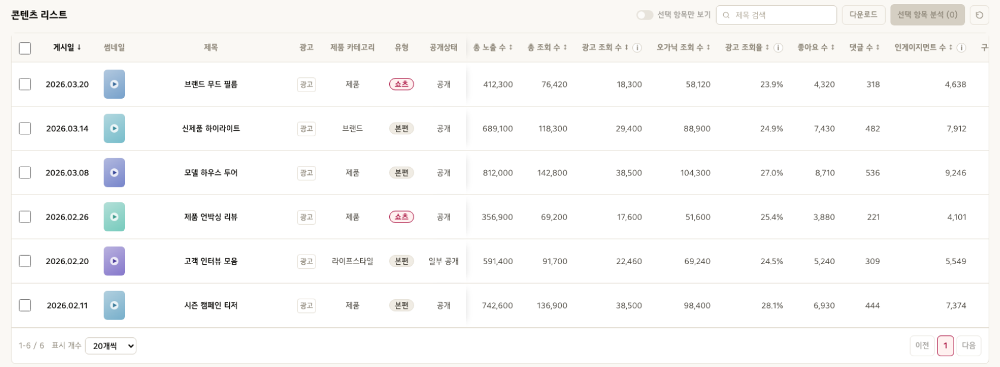

  

    <h1>프론트엔드 엔지니어 김영찬입니다</h1>
    
Frontend Engineer, Robot Data Platform 지원

  

  

    
    이력서
  

---
layout: center
---

  
01

  <h1>코가로보틱스: 양산 로봇 점검 대시보드</h1>

---
class: shot-slide
---

<h1>코가로보틱스 점검 대시보드 화면</h1>

  <FilePlaceholder name="koga-dashboard.png" />

---

  <section class="block">
    
이슈: 양산 규모로 늘어난 점검 기록

    <ul>
      <li>손 기록을 엑셀로 다시 옮김</li>
      <li>통과한 로봇을 추적하기 어려움</li>
    </ul>
  </section>
  <section v-click class="block problem">
    
문제 정의: 기록은 흩어지고 판정 기준도 없음

    <ul>
      <li>LiDAR 값이 얼마나 벗어나면 재캘리브레이션할지 기준 없음</li>
    </ul>
    

      LiDAR
      RGB-D 카메라
      LED·스피커
      구동부
    

  </section>

---

시행착오: 판정 방식을 바꿈

  
순간값 하나로 통과 판정

  →
  
출하 후 현장 이슈

  →
  
일정 구간의 평균값으로 판정

---

  

    
해결: 웹 점검 도구

    <ul class="roomy">
      <li>웹 입력 폼, 통과 여부 먼저</li>
      <li>실시간 ROS 토픽 구독, 갱신 주기 조절 (rosbridge, roslibjs)</li>
      <li>로봇별 점검 보고서</li>
    </ul>
  

  

    <FilePlaceholder name="koga-sensor.png" />
    <FilePlaceholder name="koga-drive.png" />
  

---
layout: center
---

  
배운 점

  
작업자가 묻는 순서대로 화면을 짠다

---
layout: center
---

  
02

  <h1>SNS 마케팅 데이터 대시보드</h1>

---
class: shot-slide
---

<h1>SNS 마케팅 데이터 대시보드 화면</h1>

  

YouTube, Instagram 성과를 한 화면에서 조회하고 비교하는 B2B 대시보드

---

  <section class="block">
    
이슈: 2주마다 Meta, Google Ads에 하나씩 들어가 확인

  </section>
  <section v-click class="block">
    
문제 정의

    <ul>
      <li>플랫폼마다 지표 정의가 다름</li>
      <li>오가닉과 광고를 같은 기간으로 못 봄</li>
      <li>화면 영역마다 조회 조건이 따로 걸림</li>
    </ul>
    
지표 유형

    

      누적
      일별
      비율
      도달
    

  </section>

---

시행착오

<ul class="roomy pair-list">
  <li>원본 값을 그대로 더함 → 합계 불일치</li>
  <li>비율 지표를 평균 냄 → 값이 틀림</li>
</ul>

---

해결

<ul class="roomy">
  <li>백엔드 연동 API(Meta, Google Ads)</li>
  <li>지표 유형별 집계 규칙, 다른 지표는 나란히</li>
  <li>오가닉과 광고를 같은 조회 기간에</li>
  <li>Recharts 공용 차트, 조회 조건은 전역 상태 하나</li>
</ul>

---
class: shot-slide
---

<h1>추이 차트 · 기간 비교</h1>

  

---
class: shot-slide
---

<h1>오가닉과 광고를 같은 조회 기간에</h1>

  

---
layout: center
---

  
결과

  
2주 보고서 폐지, 담당 2명에서 관리자 1명

---

성능 개선: 대시보드 첫 화면

<h1>1차: 이미지</h1>

증상: 콘텐츠가 많은 목록, 첫 화면이 한동안 빈 채로

  
원인: 화면 밖 이미지까지 처음에 한꺼번에 요청

  
해결: 첫 화면 이미지는 바로, 화면 밖만 지연 로딩 + React Server Component 초기 조회와 스켈레톤 UI

  

    
결과: LCP 3.2초 → 2.1초

    <LcpFigure />
    
크롬 개발자 도구 Lighthouse · 데스크톱 · 여러 번 측정한 평균

  

---

성능 개선: 대시보드 첫 화면

<h1>2차: 폰트와 응답 압축</h1>

  
원인: 첫 화면에서 본문 폰트 원본(OTF)을 그대로 받음

  <ul class="roomy">
    <li>해결 1: 본문 폰트 WOFF2 변환</li>
    <li>해결 2: 화면에 쓰는 821자만 담은 작은 폰트를 먼저, 전체 폰트는 필요할 때</li>
    <li>해결 3: 제목 폰트도 WOFF2로, 미리 받기는 유지</li>
    <li>해결 4: HTML·JS·CSS 응답 gzip 압축(첫 화면 전송량 1.17MB → 0.59MB)</li>
  </ul>
  
0.9초

  
결과: LCP 0.9초(네 가지 적용 후)

  
Lighthouse CLI · 데스크톱 시뮬레이션 · 조건별 7회 측정 중앙값 · 로컬 브랜치, 운영 미반영

