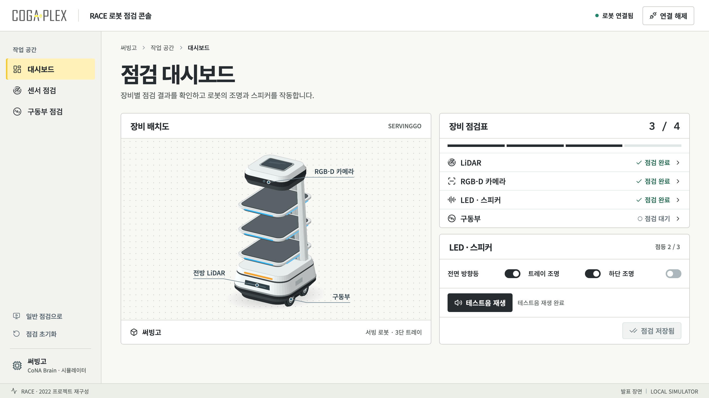
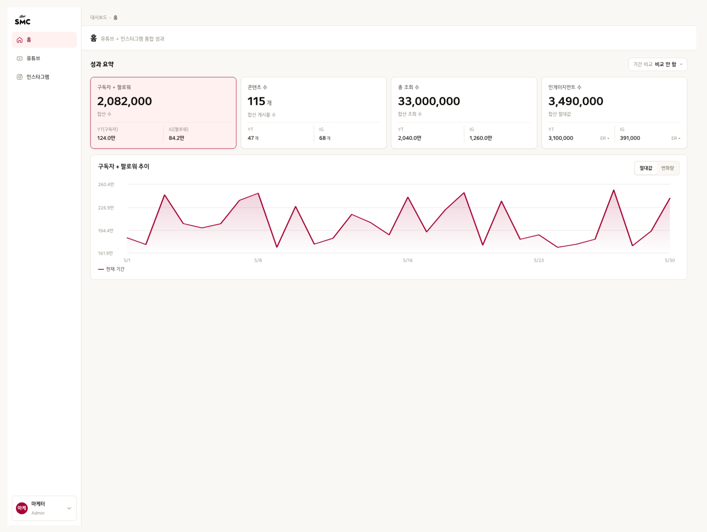
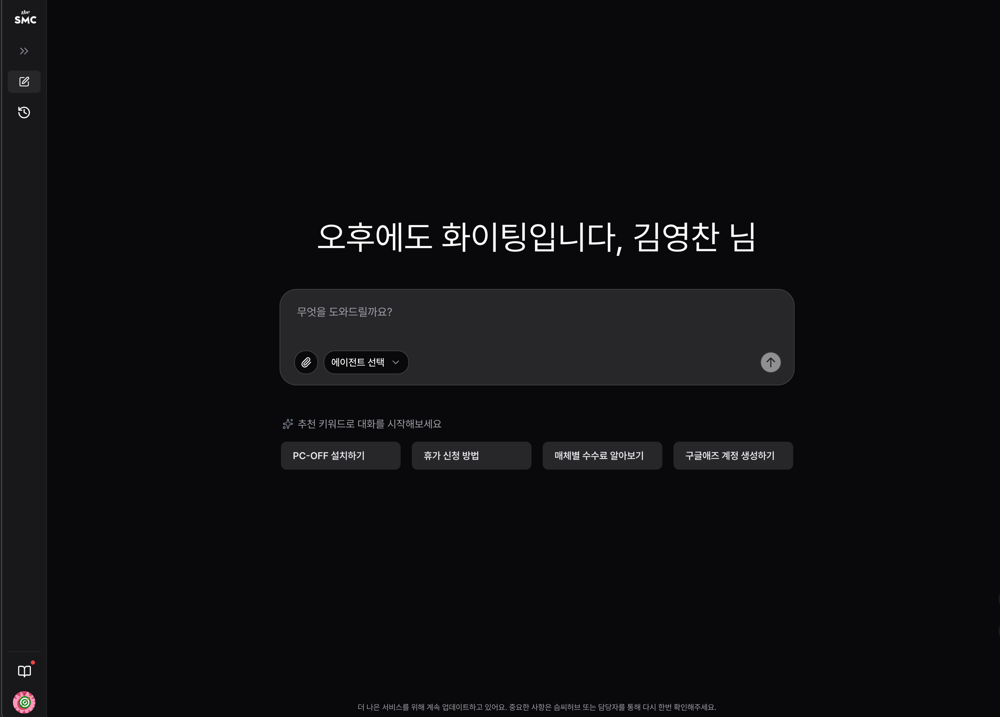
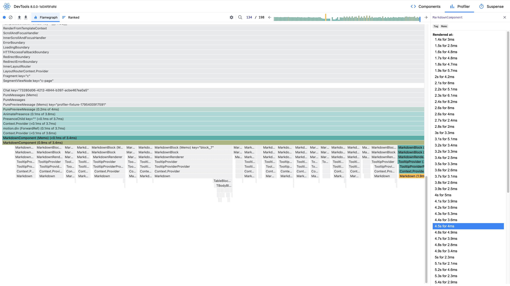
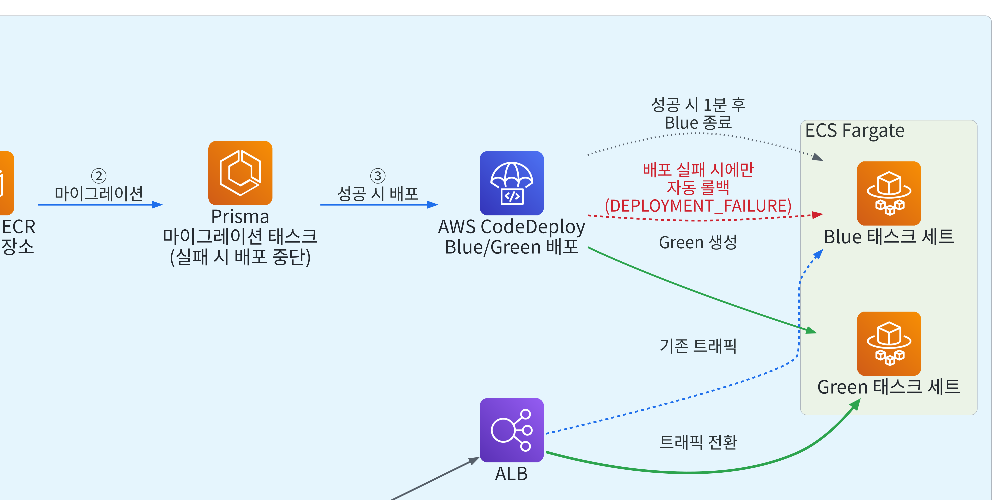

  

    <h1>프론트엔드 엔지니어 김영찬입니다</h1>
    
Frontend Engineer, Robot Data Platform 지원

  

  

    
    이력서
  

<!--
안녕하세요, 저는 복잡한 데이터를 사용자가 쉽게 판단할 수 있도록 돕는 화면을 만들어 왔습니다.
로봇 현장에서 3년, 프론트엔드 개발자로 3년 일하면서 기술은 사람이 더 나은 일을 하도록 돕는 것이라고 믿어 왔는데요.
그 믿음으로 현장의 목소리가 담긴 로봇 소프트웨어를 만들고 싶은 프론트엔드 개발자 김영찬입니다.

지금부터 제 주요 프로젝트와 직무 역량을 소개하는 발표를 시작하겠습니다.
-->

---
class: agenda
---

  <h1>차례</h1>
  <ol>
    <li>
      01
      양산 로봇 점검 대시보드
    </li>
    <li>
      02
      SNS 마케팅 데이터 대시보드
    </li>
    <li>
      03
      사내 AI 챗봇
    </li>
    <li>
      04
      AWS 인프라와 배포
    </li>
    <li>
      05
      제조 현장
    </li>
  </ol>

<!--
주요 프로젝트는 이 다섯 가지 순서입니다. 양산 로봇 점검 대시보드, SNS 마케팅 데이터 대시보드, 사내 AI 챗봇, AWS 인프라와 배포, 그리고 제조 현장입니다.
-->

---
class: chapter
---

  
01

  

    
코가로보틱스

    <h1>양산 로봇 점검 대시보드</h1>
  

<!--
먼저 양산 로봇 점검 대시보드입니다.
-->

---
class: shot
---

<h1>점검 대시보드</h1>

  
  
양산 로봇 점검 콘솔

<!--
이 화면이 양산 로봇 점검 콘솔입니다. 점검 결과를 한곳에서 보도록 만든 대시보드입니다.
-->

---
class: lead
---

<h1 class="long">로봇은 늘었는데 점검 기록은 여전히 손으로 적고 있는 문제</h1>

<!--
로봇은 늘었는데, 점검 기록은 여전히 손으로 적고 있었습니다.
-->

---
class: list
---

<h1>이슈</h1>
<ul class="points">
  <li>01손으로 적은 점검 결과를 엑셀에 다시 옮겨야 했습니다</li>
  <li>02어떤 로봇이 통과했는지 한눈에 관리하기 어려웠습니다</li>
</ul>

<!--
양산 규모가 되자, 손으로 적은 점검 결과를 다시 엑셀에 옮겨야 했습니다. 그리고 어떤 로봇이 통과했는지도 한눈에 관리하기 어려웠습니다. 이 두 가지가 이슈였습니다.
-->

---
class: lead
---

<h1 class="long">검사 통과를 판단할 기준도 대시보드에 내장해 손쉽게 관리</h1>

예: LiDAR 값이 얼마나 벗어나면 재캘리브레이션할지

<!--
검사 통과를 판단할 기준도 대시보드에 넣어서 관리하게 했습니다. 예를 들면, LiDAR 값이 얼마나 벗어나면 재캘리브레이션할지입니다.
-->

---
class: list
---

<h1>웹 점검 도구</h1>
<ul class="points">
  <li>01점검 대상: LiDAR · RGB-D 카메라 · LED·스피커 · 구동부</li>
  <li>02판정은 순간값에서 구간 평균으로</li>
  <li>03통과 여부 먼저, 실시간 ROS 토픽, 로봇별 보고서</li>
</ul>

<!--
점검 대상은 LiDAR, RGB-D 카메라, LED와 스피커, 구동부입니다. 판정은 순간값에서 구간 평균으로 합니다. 화면 맨 앞에는 통과 여부를 두고, 세부 값은 따로 둡니다. 로봇별 보고서도 있습니다.
-->

---
class: shot
---

<h1>센서 점검</h1>

  
  
센서 점검 화면

<!--
센서 점검 화면입니다. LiDAR와 RGB-D를 확인합니다.
-->

---
class: shot
---

<h1>구동부 점검</h1>

  
  
구동부 점검 화면

<!--
구동부 점검 화면입니다.
-->

---
class: chapter
---

  
02

  

    
더에스엠씨

    <h1 class="long">SNS 마케팅 데이터 대시보드</h1>
  

<!--
다음은 SNS 마케팅 데이터 대시보드입니다.
-->

---
class: shot
---

<h1>통합 성과</h1>

  

    

      
    

    
통합 화면

  

  

    
    
콘텐츠 리스트

  

<!--
YouTube와 Instagram 성과를 한 화면에서 보고, 아래는 콘텐츠 리스트입니다.
-->

---
class: list
---

<h1>기존에 일하던 방식</h1>
<ul class="points">
  <li>012주마다 Meta, Google Ads에 하나씩 들어가 확인</li>
  <li>02확인할 때마다 보고서를 보냄</li>
  <li>03이 보고를 담당 2명이 맡음</li>
</ul>

<!--
광고주와 마케터에게 2주마다 보고서를 보내야 했습니다. 그래서 확인할 때마다 Meta와 Google Ads에 각각 하나씩 들어가 확인했습니다. 이 보고는 담당 2명이 맡았습니다.
-->

---
class: list
---

<h1>그대로 합치면 틀린다</h1>
<ul class="points">
  <li>01플랫폼마다 지표 정의가 다름</li>
  <li>02누적, 일별, 비율, 도달</li>
  <li>03더하면 합계가 안 맞고, 비율을 평균 내면 값이 틀림</li>
</ul>

<!--
플랫폼마다 지표 정의가 다릅니다. 누적, 일별, 비율, 도달이 있는데, 그대로 더하면 합계가 안 맞고 비율을 평균 내면 값이 틀립니다. 그래서 규칙은 지표 유형별로 나눴습니다. 유형별 집계 규칙은 나누고, 다른 지표는 나란히 둡니다.
-->

---
class: shot
---

<h1>추이 차트 · 기간 비교</h1>

  
  
현재 기간 실선, 비교 기간 점선

<!--
이 화면은 기간을 비교하는 추이 차트입니다. 조회는 하나이고, 오가닉과 광고는 같은 기간입니다. 차트는 Recharts 공용 차트를 쓰고, 조회 조건은 전역 상태 하나로 두었습니다. 현재 기간은 실선이고, 비교 기간은 점선입니다.
-->

---
class: shot
---

<h1 class="long">오가닉과 광고를 같은 조회 기간에</h1>

  
  
콘텐츠 리스트

<!--
콘텐츠 리스트에서 오가닉과 광고를 같은 조회 기간에 봅니다.
-->

---
class: lead
---

<h1>성능 문제 : 첫 화면 지연</h1>
<ul class="points">
  <li>01화면 밖 이미지는 나중에 받음</li>
  <li>02초기 조회, 기다리는 동안 스켈레톤</li>
  <li>03쓰는 글자만 WOFF2, gzip 1.17MB에서 0.59MB</li>
</ul>

<!--
화면 밖 이미지까지 처음에 한꺼번에 요청해서, 첫 화면만 바로 받고 밖은 나중에 받게 했습니다. React Server Component에서 초기 데이터를 조회하고, 기다리는 동안 스켈레톤 UI로 화면 구조와 로딩 상태를 보여 줍니다. 본문 폰트는 OTF 원본이라 화면에 쓰는 글자만 WOFF2로 먼저 받았고, HTML, JS, CSS는 gzip으로 1.17MB에서 0.59MB가 됐습니다.
-->

---
class: num-slide
---

  
1차, 이미지

  
2차, 폰트와 압축

  <LcpFigure />
  
3.2초에서 0.9초

  
개발자 도구 Lighthouse, 데스크톱, 여러 번 측정한 평균

  
개발 직후 기준, 두 가지 적용 후. Lighthouse CLI, 데스크톱 시뮬레이션, 조건별 7회 중앙값. 로컬 브랜치, 운영 미반영

<!--
1차는 이미지입니다. 왼쪽 숫자는 3.2초에서 2.1초로 바뀝니다. 2차는 폰트와 압축이고, 두 가지를 적용한 뒤 3.2초에서 0.9초가 됐습니다. 0.9초는 개발 직후 기준입니다. 개발자 도구 Lighthouse에서 데스크톱으로 여러 번 측정한 평균이 있고, Lighthouse CLI 데스크톱 시뮬레이션으로 조건별 7회 중앙값도 있습니다. 로컬에서 측정했고, 운영에는 반영하지 않았습니다.
-->

---
class: recap
---

  
2주마다 보내던 보고서를 대시보드로 대체했습니다.

  
담당은 2명에서 1명으로 줄었습니다.

<!--
2주마다 보내던 보고서를 대시보드로 대체했습니다. 담당은 2명에서 1명으로 줄었습니다. 그런데 플랫폼마다 조회수를 세는 방식이 달랐습니다. 그래서 합치기 전에 무엇을 셌는지 확인하고, 다르면 코드에서 갈라 두었습니다.
-->

---
class: chapter
---

  
03

  

    
더에스엠씨

    <h1>사내 AI 챗봇</h1>
  

<!--
다음은 사내 AI 챗봇입니다.
-->

---
class: shot
---

<h1>사내 AI 챗봇 첫 화면</h1>

  

<!--
사내 AI 챗봇 첫 화면입니다.
-->

---
class: lead
---

<h1 class="long">사내 검색과 외부 AI 모델을 한곳에서 쓰는 채팅</h1>

<!--
사내 검색과 외부 AI 모델을 한곳에서 쓰는 채팅입니다.
-->

---
class: list
---

<h1>원인</h1>
<ul class="points">
  <li>01대화를 열면 모든 메시지를 한꺼번에 불러와 그림</li>
  <li>02스트리밍 중 바뀌지 않은 마크다운 블록까지 반복 렌더링</li>
</ul>

<!--
느린 이유는 두 가지였습니다. 대화를 열면 모든 메시지를 한꺼번에 불러와 그렸고, 스트리밍 중에는 바뀌지 않은 마크다운 블록까지 반복해서 렌더링했습니다.
-->

---
class: lead
---

<h1 class="long">최근 메시지 먼저, 스크롤하면 이전 메시지 추가</h1>

<!--
그래서 최근 메시지를 먼저 불러오고, 스크롤하면 이전 메시지를 추가하도록 바꿨습니다.
-->

---
class: lead
---

<h1 class="long">다시 그리는 블록 21개에서 1개</h1>

커밋당 렌더 시간 평균 11.5ms에서 4.4ms

React DevTools Profiler · 개발 빌드 · 같은 더미 응답 재현 측정

<!--
다시 그리는 블록은 21개에서 1개가 됐습니다. 커밋당 렌더 시간 평균은 11.5ms에서 4.4ms입니다. React DevTools Profiler로, 개발 빌드에서, 같은 더미 응답을 재현해 측정했습니다.
-->

---
class: shot
---

<h1>적용 전</h1>

  

<!--
적용 전 Profiler입니다. 마크다운 블록이 모두 다시 그려집니다.
-->

---
class: shot
---

<h1>적용 후</h1>

  

<!--
적용 후입니다. 끝난 블록은 회색이고, 하나만 색이 있습니다.
-->

---
class: recap
---

  
대화를 열면 최근 메시지부터 불러오도록 바꿨습니다.

  
답변이 나오는 동안 다시 그리는 블록이 21개에서 1개로 줄었습니다.

<!--
느린 이유를 짐작으로 고치면 시간만 든다. 숫자로 원인을 확인하고 나서야 맞는 방향이 보였다.
-->

---
class: chapter
---

  
04

  

    
더에스엠씨

    <h1 class="long">AWS 인프라와 배포</h1>
  

<!--
다음은 AWS 인프라와 배포입니다.
-->

---
class: lead
---

SNS 마케팅 데이터 대시보드 배포 인프라

<h1 class="long">배포 자동화, 실패해도 이전 버전 유지</h1>

<!--
SNS 마케팅 데이터 대시보드의 배포 인프라입니다. 배포를 자동화해서, 실패해도 이전 버전을 유지하게 했습니다.
-->

---
class: list
---

<h1>시행착오</h1>
<ul class="points">
  <li>01AWS 콘솔 수작업</li>
  <li>02관리가 어긋남</li>
  <li>03Terraform. 백엔드 개발자의 기존 구성을 참고하고 코드 리뷰 받음</li>
</ul>

<!--
처음에는 AWS 콘솔에서 수작업으로 해서 관리가 어긋났습니다. 그래서 Terraform으로 바꿨고, 백엔드 개발자의 기존 구성을 참고한 뒤 코드 리뷰를 받았습니다.
-->

---
class: shot
---

<h1>배포 파이프라인</h1>

  

<!--
배포는 GitHub Actions에서 ECR, Prisma 마이그레이션, CodeDeploy, ECS Fargate로 이어집니다.
-->

---
class: shot
---

<h1>실패하면 배포를 멈추고 롤백</h1>

  

<!--
마이그레이션이 실패하면 배포를 멈추고, 배포가 실패하면 자동으로 롤백합니다.
-->

---
class: recap
---

  
되돌릴 길이 있어야 자주 배포할 수 있다.

AWS SAA-C03 취득, 2026.10

인프라를 직접 구축해 본 뒤, 설계를 제대로 배우려고 취득

<!--
되돌릴 길이 있어야 자주 배포할 수 있습니다. AWS 인프라를 직접 구축해 본 경험을 바탕으로, 클라우드 아키텍처에 대한 이해를 넓히고 설계 역량을 기르려고 AWS SAA-C03를 2026년 10월에 취득했습니다.
-->

---
class: chapter
---

  
05

  

    
인아오리엔탈모터

    <h1>제조 현장</h1>
  

<!--
마지막으로 제조 현장입니다.
-->

---
class: lead
---

<h1 class="long">제조 현장에서 협동로봇을 직접 설치하고 검증</h1>

<!--
제조 현장에서 협동로봇을 직접 설치하고 검증했습니다.
-->

---
class: lead
---

  <h1>디든로보틱스의 로봇을 다루는 분들에게도 정말 도움이 되는 플랫폼을 제공하고 싶습니다</h1>
  
질문 받겠습니다

<!--
디든로보틱스의 로봇을 다루는 분들에게도 정말 도움이 되는 플랫폼을 제공하고 싶습니다. 질문 받겠습니다.
-->
