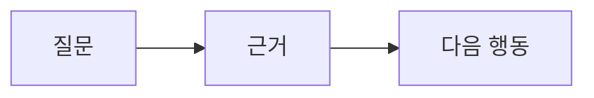
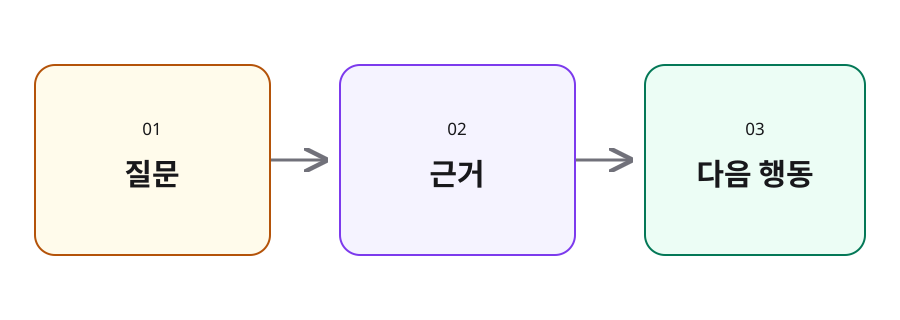

<div class="studio-kicker">SLIDE STUDIO</div>

# __TITLE__

<p class="studio-subtitle">생각을 정리하고, 한 장씩 전달합니다</p>

<div class="pt-6 font-mono text-sm opacity-70">Markdown · Vue · Slidev</div>

<!--
STUDIO_EXAMPLE_NOTE: 발표 대상과 오늘의 핵심 질문을 소개합니다.
청중에게 보여줄 문장은 본문에, 말로 풀어낼 내용은 이 노트에 둡니다.
공개 저장소의 Markdown 원본에는 이 노트도 포함됩니다.
-->

---

# 오늘의 흐름

<p class="studio-subtitle">설명할 내용을 세 갈래로 나눕니다</p>

<StudioToc :items="['핵심 메시지', '비교와 근거', '실행과 다음 단계']" :current="1" />

<!--
현재 구간은 current에 1부터 시작하는 번호로 전달합니다.
전체 목록만 보여주려면 current를 생략합니다.
-->

---

# 한 장에는 한 가지 메시지

<p class="studio-subtitle">청중이 기억할 문장부터 정합니다</p>

<v-clicks>

- 제목에 핵심을 먼저 적습니다.
- 근거는 짧은 문장과 그림으로 보여줍니다.
- 자세한 설명은 발표자 노트에 남깁니다.

</v-clicks>

<!--
세 항목은 클릭할 때 하나씩 나타납니다.
순서대로 읽으며 한 장의 정보량을 제한하는 이유를 설명합니다.
-->

---

# 비교하면 차이가 보입니다

<p class="studio-subtitle">같은 기준으로 두 가지 방향을 살펴봅니다</p>

<div class="grid grid-cols-2 gap-5 pt-2">
  <StudioCard v-click title="설명이 길어질 때" tone="rose">
    <p>여러 주제를 한꺼번에 담습니다.</p>
    <p>청중이 요점을 찾기 어렵습니다.</p>
  </StudioCard>
  <StudioCard v-click title="메시지를 나눌 때" tone="emerald">
    <p>하나의 질문에 답합니다.</p>
    <p>다음 설명으로 이어집니다.</p>
  </StudioCard>
</div>

<!--
왼쪽과 오른쪽 카드를 차례로 공개합니다.
카드의 tone은 accent, violet, sky, emerald, rose, neutral을 지원합니다.
-->

---

# 코드는 짧게 보여줍니다

<p class="studio-subtitle">실행 흐름이 드러나는 부분만 남깁니다</p>

```ts {all|2-3|5|all}
const messages = [
  '핵심을 먼저 적습니다.',
  '근거를 덧붙입니다.',
]
messages.forEach(message => console.log(message))
```

<div class="pt-5 opacity-75">코드도 복사할 수 있는 텍스트로 유지합니다.</div>

<!--
클릭하며 강조되는 줄을 따라 실행 흐름을 설명합니다.
긴 예제는 여러 장으로 나누거나 발표 폴더의 snippets에 둡니다.
-->

---

# 흐름은 그림으로 연결합니다

<p class="studio-subtitle">도식은 발표의 강조색을 함께 사용합니다</p>



<StudioCard title="그림을 읽는 순서" tone="accent" class="mt-5">
  시작점과 연결 관계를 짚은 뒤, 도착점에서 무엇을 할지 설명합니다.
</StudioCard>

<!--
Mermaid의 공통 테마는 shared 애드온이 설정합니다.
각 코드 블록에 별도 색상을 지정하면 그 블록의 설정이 우선합니다.
-->

---

# 이미지는 설명을 받쳐줍니다

<p class="studio-subtitle">발표에 필요한 파일은 이 발표의 public에 둡니다</p>



<!--
이 이미지는 템플릿에 포함된 범용 SVG 예제입니다.
발표 전용 이미지와 영상은 각 덱의 public 폴더 안에서 관리합니다.
-->

---
layout: center
---

<div class="studio-kicker">NEXT STEP</div>

# 이제 발표를 채울 차례입니다

<p class="studio-subtitle">핵심 질문 하나를 적고 첫 슬라이드부터 바꿔보세요</p>

<div class="pt-4 font-mono text-sm opacity-75">pnpm new my-talk → pnpm dev my-talk</div>

<!--
오늘의 메시지를 한 문장으로 다시 말하고 다음 행동을 제안합니다.
-->
